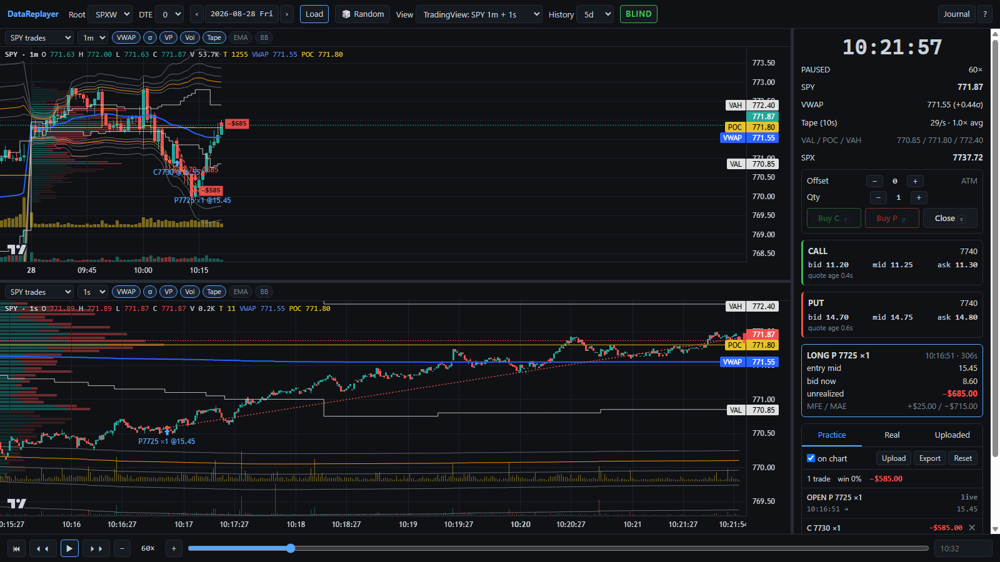

# DataReplayer

A local, browser-based **historical option replay trainer**. Replay a past trading day from your
own tick archive and practice 0–2 DTE option entries with hotkeys (`c` buy call / `p` buy put /
`x` close). Every practice fill is priced the way a real one would have been: entry at the option
**mid** and exit at the **bid**, re-priced to the exact millisecond. Nothing after the replay
clock is ever shown.

> Training and replay only. **Not** a backtester, **not** a live trader. It never places orders,
> never talks to a broker, and never streams live data.



## Features

- **Tick-faithful replay** of one session at 0.25×–60× (or Max), with a smooth clock, step / seek
  / jump-to-time, and **BLIND** (future hidden) or **REVIEW** (whole day) modes.
- **TradingView-style charts**, each pane with its own source and interval: SPY 1m + 1s by
  default, plus underlying and option C/P views. They include:
  - session VWAP with ±1.8/2/2.2/2.5/3σ bands;
  - a developing POC / VAH / VAL and volume profile;
  - volume, and tape speed (trades per bar);
  - EMA and Bollinger bands on any source timeframe (1s … 1h, 1D).
- **Prior-day context:** 3 / 5 / 10 earlier sessions on the 1m chart, each with its own VWAP and
  profile.
- **Sub-second replay:** the forming bar moves with the tape four times a second, and is never
  ahead of the clock.
- **Practice trading:** offset and quantity, a position card with unrealized P&L and MFE / MAE,
  and entry→exit lines with P&L drawn on the chart. A journal keeps the trades, with Export and
  Reset.
- **Trade overlays:** your real broker fills (read-only, from an `order_history.json`) or an
  uploaded JSON, paired into round trips and drawn on the chart.
- **Random blind practice:** load a random session with its date hidden until you reveal it.
- **No look-ahead anywhere.** This is the integrity core, and it is unit-tested. See
  [docs/DESIGN.md](docs/DESIGN.md).

**Tour with screenshots: [docs/GUIDE.md](docs/GUIDE.md).**

## Requirements

- Python 3.11+ with `numpy`, `pandas`, `pyarrow` (`pip install -r requirements.txt`).
  `pandas_market_calendars` is optional (exact NYSE holidays; a computed set is used without it).
- A modern browser. The chart library loads from unpkg, so the first load needs internet access.
- Node 18+ only to run the JS engine tests.
- **Your own market data.** No data is included. The tool expects a ThetaData-style parquet
  archive:
  - options: per-expiry tick files with the NBBO, plus greeks for index roots;
  - stocks: 1s quotes and per-trade tapes.

  Roots SPY, QQQ, IWM and SPXW are supported. The exact layout, columns and conventions are in
  **[docs/DATA.md](docs/DATA.md)**.

## Setup

```
pip install -r requirements.txt
cp config.example.json config.local.json      # then point it at your archive
python -m replayer.server                     # http://127.0.0.1:8765/  (localhost only)
```

To use it from other PCs on your network, run `python -m replayer.server --host 0.0.0.0` and open
`http://<this-pc's-LAN-IP>:8765/`. There is **no authentication**: anyone on that network can see
your journal and broker trades and add or delete practice trades. Only do this on a network you
trust, and never forward the port to the internet.

`config.local.json` is git-ignored. Every key can also be set as an environment variable:

- `THETA_PARQUET`, `THETA_STOCK`: the archive roots;
- `OPTIONS_FIRST`, `OPTIONS_LAST`: your archive's date range;
- `ORDER_HISTORY`: optional broker fills;
- `REPLAYER_JOURNAL`, `REPLAYER_CACHE`, `STRIKE_WINDOW`.

Other commands:

```
python tests/run_all.py                                   # offline tests (synthetic archive)
python -m replayer.slicer 2026-08-28 SPXW 0 --out s.json  # slice one session to JSON (CLI)
```

Deep link: `/?root=SPXW&dte=0&date=2026-08-28&t=10:32&mode=review&view=tv&speed=60&play=1`.
Press `?` in the UI for all keys.

## Keys

| Key | Action |
|---|---|
| `c` / `p` / `x` | buy call @ mid / buy put @ mid / close @ bid (BLIND only, long only, one position) |
| `,` `.` / `;` `'` | strike offset − / + (+ = OTM) / quantity − / + |
| `space` | play / pause |
| `←` `→` | step one bar (Shift steps by the coarsest pane) |
| `[` `]` | speed down / up |
| `Home` `End` | jump to the open / close |
| `g` | go to a time |
| `v` | BLIND / REVIEW |
| `r` | random blind session |
| `j` | trades list |
| `?` | help |

Mouse: drag the chart to pan; scroll or drag the price axis to unlock price (**A** or a
double-click re-locks it); **⟫** jumps back to the newest bar; drag the dividers to resize.

## Privacy

Your practice journal (`journal/`), uploads, `order_history.json`, `config.local.json` and the
cache are git-ignored and stay on your machine. The broker file is only ever read. The server
binds to `127.0.0.1` unless you pass `--host`.

## Docs

- [docs/GUIDE.md](docs/GUIDE.md): feature tour with screenshots.
- [docs/DATA.md](docs/DATA.md): expected archive layout and columns, time conventions,
  trade-condition filters, trade-file and journal schemas, slice JSON, HTTP API.
- [docs/DESIGN.md](docs/DESIGN.md): the pricing contract, the no-look-ahead rules, the data
  quirks handled, the architecture and the tests.
- [docs/SPEC.md](docs/SPEC.md): the original build spec. Its paths are the author's setup; yours
  come from `config.local.json`.
- [CLAUDE.md](CLAUDE.md): guardrails for AI-assisted development in this repo.

## Stack

Python (`pandas` + `pyarrow`) slicer and a stdlib HTTP server; static HTML/JS with TradingView
[lightweight-charts](https://github.com/tradingview/lightweight-charts) 4.2 (Apache-2.0). No
build step, no cloud, no database.

## License

[MIT](LICENSE). Market data is not included and is subject to your data provider's terms.
