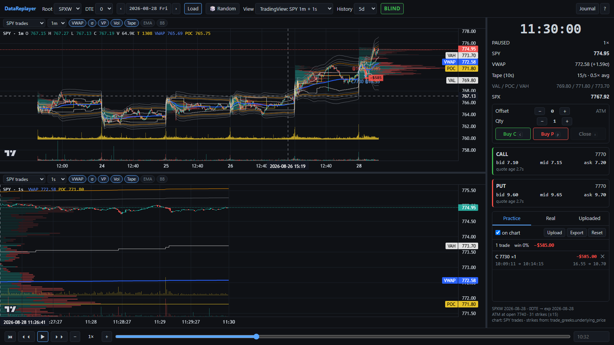
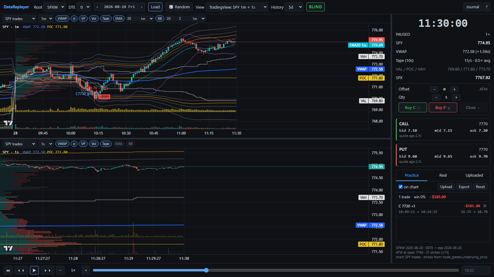
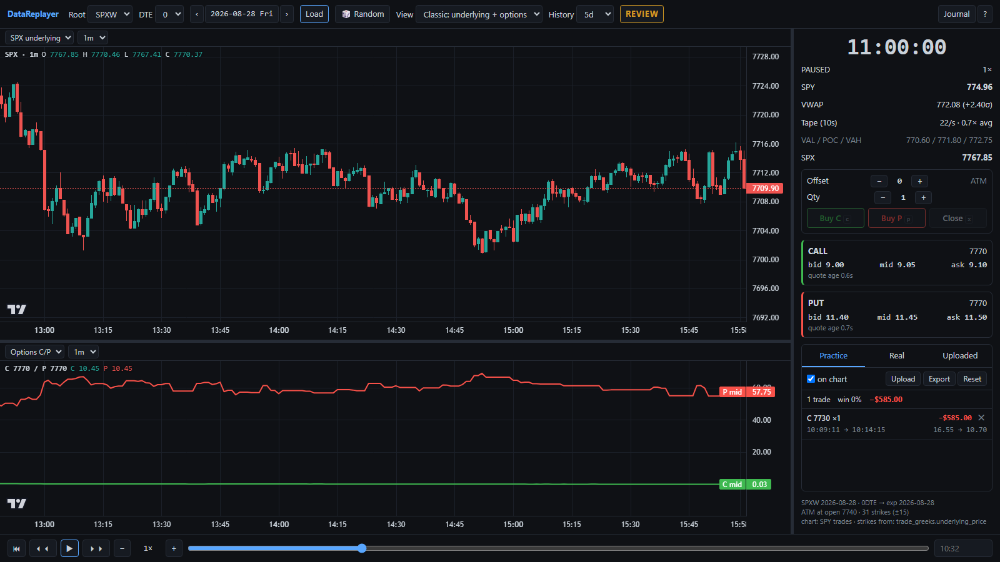
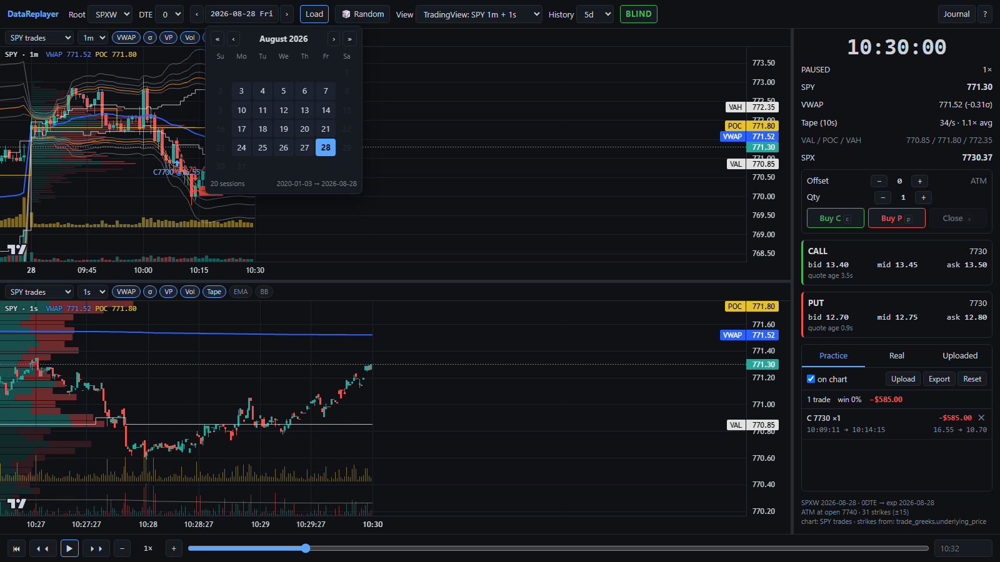
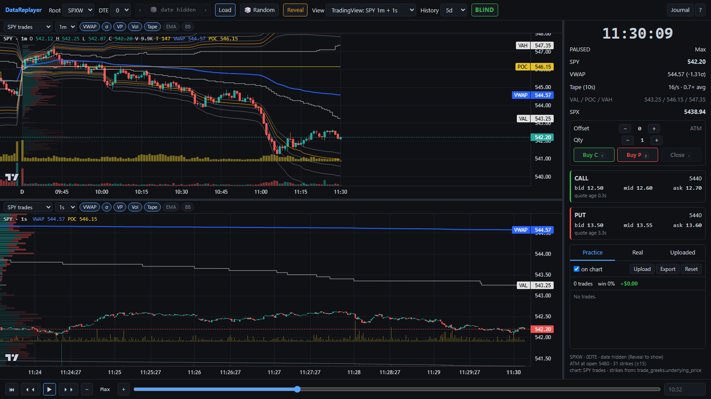
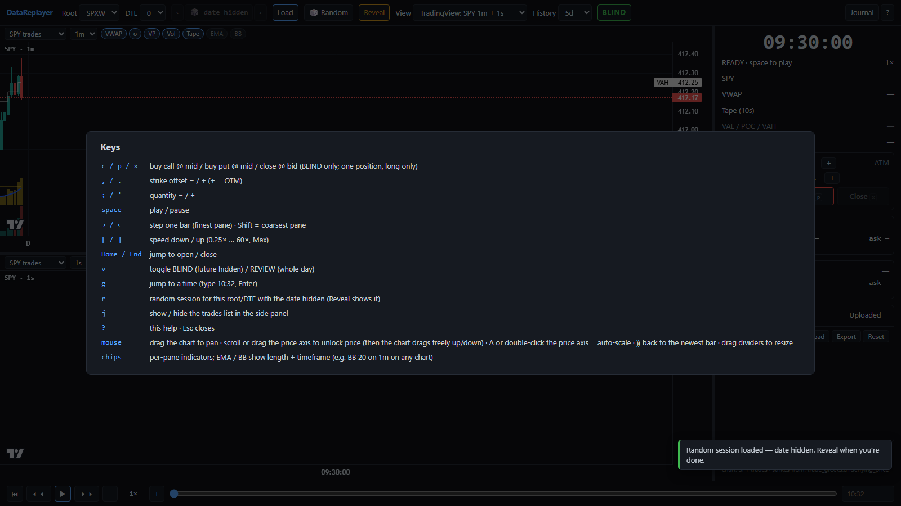

# DataReplayer — feature guide

A tour of the replay UI with screenshots. All shots are real SPXW 0DTE sessions from the archive
(practice trades in them were made on a scratch journal). Run the server with
`python -m replayer.server` and open `http://127.0.0.1:8765/`; press `?` for keys.

## Practice trading

- **`c` / `p`** buy the offset-selected call / put at the option **mid**; **`x`** closes at the
  **bid** — the live hotkey tool's pricing, so practice fills equal reality. Long only, one
  position at a time, BLIND mode only.
- **Scale in:** while holding a put, `p` again (the button reads **Add P**) adds `qty` more of
  the same contract at the mid. The entry becomes the weighted average, each add gets its own
  chart arrow (`+1 @19.90`), and `c` is refused until you close with `x`.
- Every fill is **re-priced server-side at the exact millisecond** from the full tick tape.
- **Offset** (`,` `.`) shifts the strike from ATM (+ = OTM); **Qty** with `;` `'`.
- The side panel shows the clock, SPY / VWAP (σ distance) / tape speed / VA / SPX, the CALL and PUT
  quotes at the current offset (with quote age), and the **position card**: entry mid, bid now,
  unrealized P&L and MFE / MAE.
- Trades are drawn on both charts: entry / exit markers and a **dashed entry→exit line with the
  P&L tag**; an open position draws a dotted line to now.
- The **trades list** sits under the quotes in the same panel: tabs **Practice / Real / Uploaded**,
  per-session summary (count, win rate, total P&L), `on chart` toggle, **Upload** (JSON in
  `order_history.json` shape, a practice export, or any list of round trips), **Export**, and
  **Reset** (deletes this session's practice trades after a confirm). `j` hides / shows it.
- Uploaded files are **remembered across days and reloads**: a multi-day file (e.g. a backtest)
  shows each session's trades when you load it. **Clear** forgets them. In BLIND they appear as
  the clock reaches them — press `v` to see the whole day.

## Mock trading for analysis (watch log, skips, notes)

For handing your decisions to someone (or something) that will try to infer your rules:

- Run with a **separate journal** for the exercise, e.g.
  `REPLAYER_JOURNAL=journal/mock_a11.jsonl python -m replayer.server`, so older practice doesn't
  mix in. Its watch log is written next to it (`journal/mock_a11_watch.jsonl`).
- The **watch log** is automatic. It records:
  - every BLIND stretch you play or step through, as *spans* grouped into *passes*;
  - every jump back or forward;
  - every switch to REVIEW;
  - every Load.

  It writes about every 15 s and when you leave.
- A trade whose entry falls on time you'd already watched in an **earlier pass** (you rewound) is
  flagged `after_rewind` (↺ in the list). One taken after REVIEW was opened on that session is
  flagged `after_review` (R).
- **`s` = skip:** "I saw a setup and passed". It pauses and asks for an optional reason. Enter
  saves, Esc cancels. Skips appear in the list and as grey `skip` dots on the chart.
- **Notes:** click a trade, a skip or the open position in the Practice list to add or edit a
  one-line reason, for example "3rd touch, failed push". **⏱** on a row jumps the clock there. In
  BLIND, jumping back counts as a rewind.
- **Skip the dead zone (`n`):** jumps to the next 1s close beyond **±kσ of VWAP** (k = 1.5 by
  default, set in the footer, and drawn as a dashed band on the charts). If price is already
  outside, it first waits for price to come back inside and stay there for 30 s. **Stop early**
  (30 s / 60 s / 2 m) lands before the move so you can watch the approach. The search moves forward
  one second at a time using only data up to each second, so it lands exactly where pausing on the
  breakout would. It's refused while you're in a position. The watch log marks these jumps
  `rule: "zone"`, so the skipped time reads as "inside the zone, by rule".
- **Second `n` rule, the outsized candle:** `n` also stops **2 s after** a 1s candle whose high−low
  is at least **F×** (default 3, footer "bar ≥ F ×5m", 0 = off) the largest 1s range of the previous
  5 minutes. That's spikes like 2026-08-14 09:51:23 ($0.63 against a 5-minute max of $0.10), which
  fires 2–4 times a typical day. Stopping after the candle (never on or before it) keeps it
  look-ahead-free. It needs a full 5 minutes of history, so it is quiet until 09:35. `n` goes to
  whichever rule fires first; the watch log records which (`stop: "sigma" | "candle" | "close"`). **Ctrl+→** jumps 30 s,
  **Ctrl+Shift+→** 5 min.
- **Export all** downloads every practice trade plus the whole watch log in one JSON file. Or
  point the analysis at the two `.jsonl` files directly.

## TradingView layout + prior days

- Default view **TradingView: SPY 1m + 1s** — SPY is the chart proxy for SPXW (strikes still come
  from real SPX).
- Each chart: session **VWAP** (blue) with **±1.8 / 2 / 2.2 / 2.5 / 3σ** bands (2σ orange),
  **volume**, **developing POC / VAH / VAL** and the volume profile, plus the **Tape** histogram
  (trades per bar — the tape's tempo, above volume).
- **History** (0 / 3 / 5 / 10 days) prepends prior sessions to 1m+ panes, each with its own VWAP,
  bands and profile drawn inside its own span.
- OHLC uses only regular / ISO prints (no bad-print wicks); VWAP / σ are exact trade-level values.
- The forming bar updates **4× per second** when trades change it (sub-second replay), so busy
  moments flicker and quiet ones sit still — never ahead of the clock.

## Per-pane indicators

- Each pane has its own chips: **VWAP, σ, VP, Vol, Tape, EMA, BB**.
- **EMA** and **BB** take a length and a **source timeframe** (1s … 1h, or **1D**): e.g. BB 20 on
  1m shows the last-20-minutes band on the 1s chart too; EMA 20 on 1D is a 20-day EMA (prior
  daily closes + today's developing close).
- Price scale works like TradingView: auto by default; **scroll or drag the price axis to unlock**
  it, then the chart drags freely up / down. **A** or double-click the axis re-locks; **⟫** jumps
  back to the newest bar.
- Drag the dividers to resize panes and the side panel (remembered).

## Other views

- **View** presets: TradingView (SPY 1m + 1s), **Classic** (underlying + option C/P mids),
  **SPY 1m + options**, or **Custom** — pick Source (SPY trades / Underlying / Options C/P / Hidden)
  and Interval per pane. No view is ever removed.
- **BLIND** (default) hides everything after the clock; **REVIEW** (`v`) shows the whole day and
  refuses trades.

## Picking a session

- The calendar enables only sessions that exist in the archive for the root / DTE (so weekends are
  off for SPX, but would show for a weekend-trading source). `‹` `›` step to the previous / next
  session; **Load** resets the axes to the new day.

## Random blind practice

- **🎲 Random** (`r`) loads a random session with the **date hidden** everywhere — date button,
  meta, Real tab, chart labels (D, D-1, …) — until **Reveal**. Price levels still hint at the era.

## Keys

The timeline under the charts has a tape-measure ruler: a tick every 5 minutes, longer at :15 /
:45 and :30, tallest on the hour with a small hour number.

`space` play / pause · `←` `→` step a bar (Shift = coarsest pane) · `[` `]` speed (0.25× … 60×, Max)
· `Ctrl+→` +30 s (Shift: +5 min) · `n` skip to the next ±kσ move · `Home` / `End` open / close · `s` skip · `g` jump to a time · `v` BLIND / REVIEW · `r` random · `j` trades
list · `?` help.
